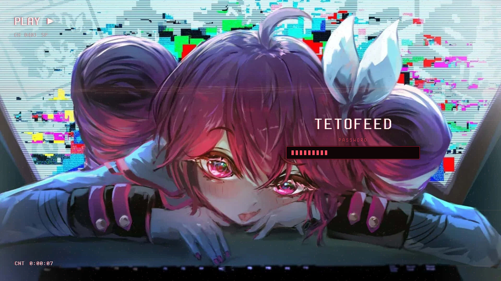
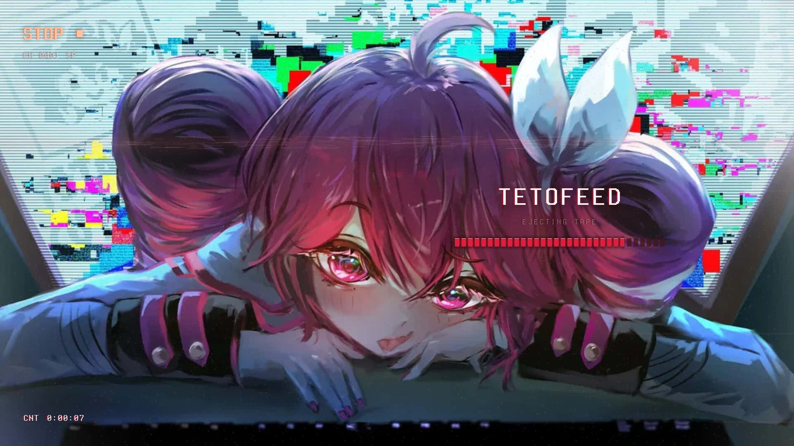

# Tetofeed — Plymouth Boot Splash

Tetofeed is a red twindrilled VHS boot splash: the crimson face under scanlines and grain, a rolling tracking band, VCR OSD, tape-block progress.


## Features

- Live grain, a tracking band rolling top to bottom, and an occasional tape wobble of the picture.
- VCR OSD: `PLAY ▶` blinks while the deck engages, plus `CH 0401 SP` and a tape counter that ticks every second.
- Boot progress as a strip of 32 crimson tape blocks under a glowing **TETOFEED**.
- Shutdown shows `STOP ■` / **EJECTING TAPE**, reboot shows `REW ◀◀`.
- Disk-unlock prompt (LUKS): a glowing field with block bullets.
- Every word is pre-rendered, so no fonts are needed in the initramfs. Laid out for 16:9 and scaled by screen height.




## Requirements

Plymouth with the `script` plugin (standard).

## Install

```bash
git clone https://github.com/sheepy1335/tetofeed-plymouth
cd tetofeed-plymouth && sudo ./install.sh
```

Or from the KDE Store: System Settings → Colors & Themes → Boot Splash Screen → Get New... → Tetofeed Plymouth,
- Or extract to `/usr/share/plymouth/themes/`, then `sudo plymouth-set-default-theme -R tetofeed` (on dracut systems: `sudo plymouth-set-default-theme tetofeed && sudo dracut -f`).

## Configuration

Make sure `splash` is on the kernel command line.

## The rest of the suite

| piece | repo |
|---|---|
| SDDM login | [tetofeed-sddm](https://github.com/sheepy1335/tetofeed-sddm) |
| Global theme + splash screen | [tetofeed-global](https://github.com/sheepy1335/tetofeed-global) |
| Plasma splash screen | [tetofeed-splash](https://github.com/sheepy1335/tetofeed-splash) |
| Plasma style (panel, popups) | [tetofeed-plasma](https://github.com/sheepy1335/tetofeed-plasma) |
| Aurorae window decoration | [tetofeed-aurorae](https://github.com/sheepy1335/tetofeed-aurorae) |
| Colour scheme | [tetofeed-colors](https://github.com/sheepy1335/tetofeed-colors) |
| Kvantum widget style | [tetofeed-kvantum](https://github.com/sheepy1335/tetofeed-kvantum) |
| Icon theme | [tetofeed-icons](https://github.com/sheepy1335/tetofeed-icons) |
| Konsole + kitty colours | [tetofeed-konsole](https://github.com/sheepy1335/tetofeed-konsole) |

Everything at once, with the generators: [tetofeed](https://github.com/sheepy1335/tetofeed).

## Tags

`tetofeed` `kde` `plasma6` `dark` `vhs` `scanlines` `crimson` `red` `blood` `horror` `retro` `analog-horror` `glow` `plymouth` `plymouth-theme` `boot-splash` `bootscreen` `luks`

## Credits and licence

- By sheepy1335, customised from [Bloodfeed Plymouth](https://github.com/numbpill3d/bloodfeed-plymouth) by numbpill3d. GPL-3.0-or-later.
- Wallpaper is from [wallpapers.com](https://wallpapers.com/wallpapers/kasane-teto-digital-art-qtho2b0qil6f2n3q.html)
